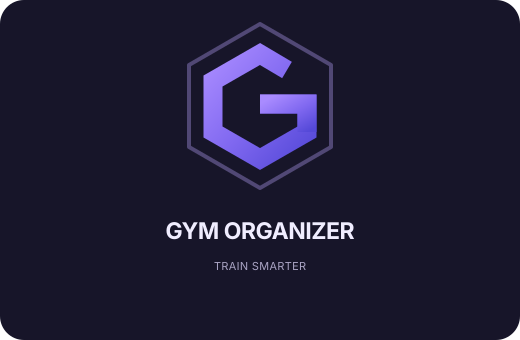

  

  <a href="https://github.com/TutsGita/GymOrganizer/releases/download/v0.4.1/GymOrganizer-0.4.1.apk"><strong>⬇ Baixar APK 0.4.1</strong></a>

# Gym Organizer

Monte sua ficha, registre séries e acompanhe a evolução das cargas no Android. Treinos, instruções e histórico ficam no celular e funcionam offline.

- **Planejamento.** Organize as fichas por dia ou em sequência A/B/C. Escolha entre 1.298 exercícios com instruções em português ou cadastre os seus.
- **Durante o treino.** Marque séries, ajuste cargas, registre drop sets e controle o descanso.
- **Evolução.** Consulte frequência, tempo de treino e pesagens no calendário.

## Balanças Bluetooth

Em **Perfil**, toque em **Procurar balança** e faça a pesagem em kg. Escolha o perfil da pessoa e confirme a leitura para salvá-la no calendário. Cada perfil mantém seus próprios dados e pesagens. Use **Criar cartão** em uma pesagem para exportar a composição como PNG.

| Modelo ou protocolo | Dados recebidos |
| --- | --- |
| OKOK V20 e C0 | Peso e impedância quando transmitida |
| Xiaomi Mi Body Composition Scale 2 | Peso e impedância quando transmitida |
| PICOOC Mini Lite (PICOOC-L) | Peso e impedância quando transmitida |
| QN e Renpho com anúncio AABB, incluindo FITINDEX FT-26R | Peso |

A compatibilidade depende do protocolo do modelo. A versão 0.2.1 teve os formatos de dados verificados por testes de software. A leitura de peso OKOK também foi confirmada em aparelho físico.

O perfil e o calendário exibem peso, impedância em ohms e estimativas separadas de água, gordura, músculo e massa óssea. Com uma leitura de impedância, o cálculo segue os coeficientes documentados em [okok-bia-formulas](https://github.com/100nandoo/okok-bia-formulas). Sem impedância, água e gordura usam as equações de [Watson](https://doi.org/10.1093/ajcn/33.1.27) e [Deurenberg](https://pubmed.ncbi.nlm.nih.gov/2043597/). A massa óssea é uma aproximação de massa mineral, sem medição de densidade óssea.

## Instalação e desenvolvimento

Baixe o APK no topo da página. Requer Android 8.0 ou superior. Para compilar, use JDK 17, Android SDK 35 e o comando `./gradlew :app:assembleDebug` (Windows: `.\gradlew.bat :app:assembleDebug`).

Em **Perfil**, consulte o histórico de versões offline e verifique atualizações. A partir da 0.3.2, as novas versões podem ser baixadas no próprio app. O Android pede confirmação para instalar.

[Histórico de versões](CHANGELOG.md)

## Planos, treinos e nutrição

- O botão central **Iniciar** abre os planos, as fichas avulsas e o treino em andamento. Abra um plano e toque em **Exportar PDF** para salvar a sequência ou semana, com exercícios, séries, repetições, cargas e notas.
- Em **Nutrição → Água**, registre o consumo, ajuste a meta e configure lembretes opcionais.
- Em **Nutrição → Alimentação**, consulte a TACO online ou cadastre um alimento pela tabela do rótulo. No Android com Google Play Services, a câmera lê o código. A busca do produto usa o Open Food Facts. Os diários salvos ficam disponíveis offline.
- A meta calórica usa peso, altura, idade, atividade e objetivo. Quando disponível e dentro dos limites de plausibilidade do app, a estimativa de repouso usa o modelo OKOK com impedância. Sem essa estimativa, usa [Mifflin–St Jeor](https://pubmed.ncbi.nlm.nih.gov/2305711/). As metas são referências para adultos. Consulte profissionais de saúde e nutrição para metas individuais.
- Os textos em português e as imagens do catálogo ficam disponíveis offline. Em **Treinos → Exercícios**, o filtro **Somente exercícios com foto e vídeo** mostra as fichas com as duas mídias. Para assistir sem internet, use **Salvar vídeo offline**.

## Corridas e pedais

Em **Calendário → Corridas e pedais**, registre modalidade, início, duração, distância e notas. Os registros permanecem no perfil local.

Em **Perfil → Conquistas**, consulte as medalhas de corrida, pedal e musculação. Abra o registro pela própria medalha para corrigir uma atividade, ajustar cargas ou excluir o lançamento. Em **Perfil → Missões**, acompanhe as metas diárias e semanais. Exercícios e missões dão XP ao perfil ativo, com seis elos entre Ferro e Diamante. Corrigir registros recalcula o progresso.

## Backup dos dados

Em **Perfil → Backup dos dados**, toque em **Exportar backup** para salvar perfis, fichas, planos e históricos em um arquivo JSON. Para restaurar, toque em **Importar backup** e escolha o arquivo. O app valida o conteúdo e pede confirmação antes de substituir os dados do aparelho. O backup automático do Android também guarda esses dados, sem os vídeos salvos.

## Roadmap

Backup em nuvem próprio, além da exportação em arquivo e do backup automático do Android.

## Licenças e créditos

O código próprio do Gym Organizer é distribuído sob a [licença MIT](LICENSE). As fontes de exercícios, imagens e vídeos, as referências de balanças e nutrição e os componentes de terceiros estão em [Créditos e licenças](docs/credits.md).
